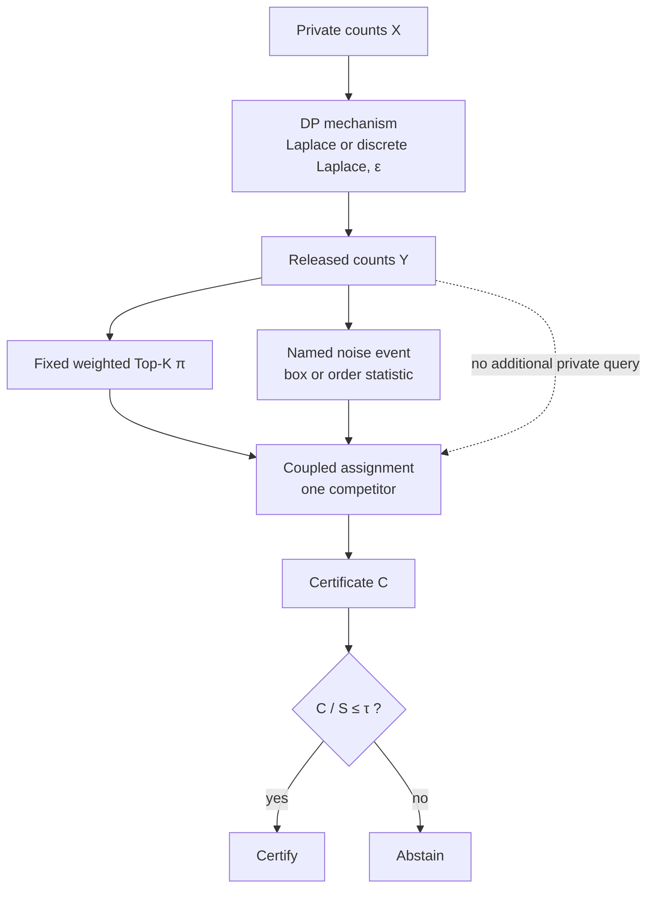
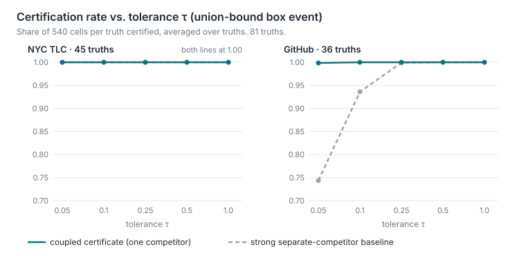
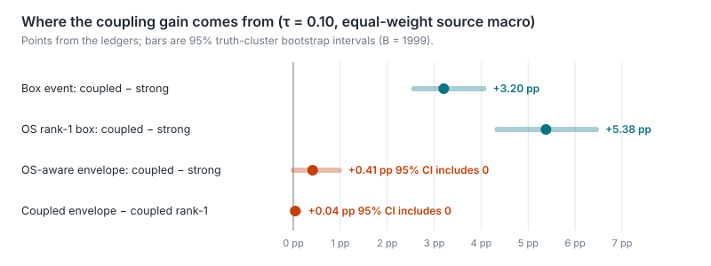
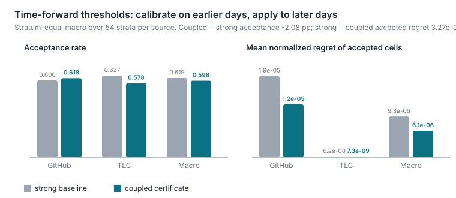

# One Competitor, One Certificate

**Coupling weighted Top-K regret after differentially private count releases.**

A differentially private count vector has been published, and a weighted Top-K list has been read off it. How much weighted regret could that list carry with respect to the true counts? This repository computes a certificate for that question from the released vector and the declared noise mechanism alone. It spends no additional privacy budget and makes no additional private query.

## Contents

- [Problem](#problem)
- [One competitor, one certificate](#one-competitor-one-certificate-1)
- [What is exact and what is a bound](#what-is-exact-and-what-is-a-bound)
- [Results](#results)
- [Quickstart](#quickstart)
- [Repository layout](#repository-layout)
- [Experiments](#experiments)
- [Data](#data)
- [Limitations](#limitations)
- [License](#license)

## Problem

A publisher releases `Y = X + noise` for a count vector `X` (Laplace or discrete Laplace noise, budget ε) and deploys the weighted Top-K list `π` read off `Y`. A downstream user sees `Y`, `π`, and the mechanism, but not `X`. The question is whether `π` is provably close to the best weighted Top-K list under `X`, using nothing beyond what is already public.

The answer is a certificate `C`: an upper bound on the weighted regret of `π` that holds on a named noise event with known probability. The list is certified when `C / S ≤ τ`, where `S = max(U(Y⁺), 10⁻⁶)` is the released utility scale. Otherwise the user abstains.

## One competitor, one certificate

Regret compares `π` with a single competitor list. That one competitor must explain two things at once: the evidence in the release, which favors `π`, and the noise slack, which allows other items to be larger than they look.

The usual strong baseline bounds these two terms separately, so each term may be maximized by a different competitor. The coupled certificate forces both terms onto one injective rank-to-item assignment. On the coordinate box event the resulting problem is a rectangular linear assignment, and its optimum is the exact maximum regret over that event. The coupled certificate is therefore never looser than the separated baseline on the same event, and it remains a valid bound.



## What is exact and what is a bound

| Method | Event | Status | Role |
| --- | --- | --- | --- |
| `C_box` (union or direct calibration) | coordinate box | Exact on the event | Coupled certificate, one assignment |
| `C_box_plus` | box ∩ nonnegative counts | Exact on the event | Count-feasible coupled certificate |
| `C_sep`, `C_rank`, `C_pair`, `C_block5` | coordinate box | Valid upper bound | Relaxations of the coupled assignment |
| `C_strong` | coordinate box | Baseline upper bound | Separate competitors; comparison only |
| OS rank-1 box, coupled and strong | order statistic | Valid upper bound | Rank-1 order-statistic bounds |
| OS coupled envelope | order statistic | Valid upper bound | Assignment envelope on the order-statistic event |
| m-swap (`certificate_mswap_os`) | order statistic | **Known invalid** | Not for certification; the default call raises |
| `certificate_min_valid` | — | Closed | Always raises |

The full registry is [`docs/METHOD_STATUS.json`](docs/METHOD_STATUS.json). `tests/integration/test_mswap_fail_closed.py` enforces that m-swap fails closed, and `tests/test_os_validity.py` holds the counterexample that rules it out.

## Results

The real-data panel contains **81 truths**: 45 daily NYC TLC yellow-taxi pickup-zone count vectors (261 zones) and 36 daily GitHub Archive repository event-count vectors (2,000 repositories). Each truth is evaluated on 540 cells: two mechanisms × three ε × three k × three weightings × ten noise replicates. That gives **43,740** certificate evaluations at τ = 0.10. `make check-claims` recomputes every number below from the ledger rows. Intervals are 95% truth-cluster bootstrap intervals.

| Comparison (τ = 0.10) | TLC | GitHub | Source macro | 95% interval (macro) |
| --- | --- | --- | --- | --- |
| Box event: coupled minus strong certification rate | 0 pp | +6.40 pp | **+3.20 pp** | [+2.56, +4.06] pp |
| Order-statistic rank-1 box: coupled minus strong | | | +5.38 pp | [+4.34, +6.45] pp |
| Order-statistic envelope: coupled minus strong | | | +0.41 pp | [0, +0.98] pp, includes 0 |
| Coupled envelope minus coupled rank-1 box | | | +0.04 pp (16 cells) | [0, +0.12] pp |

On TLC both certificates already certify every cell, so the gain there is exactly zero. At a matched certification rate of 0.50, coupling lowers the mean normalized regret of the certified lists by 2.978e-06 (macro; 95% interval [1.28e-06, 4.87e-06]). On a time-forward split, where τ is calibrated on earlier days and applied to later days, the coupled rule accepts 59.78% of cells against 61.86% for strong, and the lists it accepts have lower regret (6.05e-06 against 9.33e-06). The acceptance difference has a 95% interval of [−10.5, +6.55] pp, so no large utility gain is claimed.

<p align="center">
  
</p>
<p align="center">
  
</p>
<p align="center">
  
</p>

`make figures` draws the figures from the committed outputs. Their input hashes and plotted values are listed in [`figures/FIGURE_DATA.json`](figures/FIGURE_DATA.json).

## Quickstart

Requirements: CPython 3.11 on `PATH` as `python3.11` (or pass `PYTHON=/path/to/python3.11`), `make`, and network access to PyPI.

```bash
git clone https://github.com/XianghuiMeng-1020/topk-regret-certification.git
cd topk-regret-certification

make setup          # two virtual environments from the lock files
make verify         # environment, clean-room imports, every committed output against its checksum
make test           # full test suite in both environments
make check-claims   # recompute every reported number from the ledger rows
```

None of these commands downloads data. To rebuild everything from the public sources:

```bash
make data           # 54 hash-pinned public objects, about 5.9 GB
make reproduce      # rerun all experiments into reproductions/<run id>/ and compare with the committed outputs
```

`make reproduce` never writes under `experiments/`. Each run leaves a `run_manifest.json`, a file-by-file `comparison.json`, `stage_metrics.json`, and `claim_check.json` in its own directory. See [`docs/REPRODUCIBILITY_GUIDE.md`](docs/REPRODUCIBILITY_GUIDE.md) for the details, measured run times, and the two pinned environments.

## Repository layout

| Path | Contents |
| --- | --- |
| [`src/private_mobility_cert/`](src/private_mobility_cert/) | Library: privacy mechanisms, Top-K tasks, and all certificates |
| [`experiments/`](experiments/) | One directory per experiment, holding its runner and its committed outputs |
| [`tests/`](tests/) | Unit, mathematical, integration, and result-regression tests |
| [`scripts/`](scripts/) | Data bootstrap, verification, claim checking, reproduction, figures |
| [`manifests/`](manifests/) | Source-object pins and the registry of reported numbers |
| [`checksums/`](checksums/) | SHA-256 of every committed experiment output and every source object |
| [`data/`](data/) | Location of the public source objects (fetched, not committed) |
| [`figures/`](figures/) | SVG figures and the data behind them |
| [`docs/`](docs/) | Reproducibility guide and method status registry |

## Experiments

Run order follows the table. Each real-data runner checks the SHA-256 of its inputs before it starts.

| Directory | What it does | Environment |
| --- | --- | --- |
| [`synthetic_box_calibration`](experiments/synthetic_box_calibration/) | Union-bound and direct joint box calibration on synthetic instances, with the canonical decision-level summary | synthetic |
| [`synthetic_order_statistic`](experiments/synthetic_order_statistic/) | Order-statistic event validity and the coupled envelope on synthetic instances | synthetic |
| [`synthetic_count_feasibility`](experiments/synthetic_count_feasibility/) | Nonnegative count feasibility, low-count stress panel, and relaxation closure | synthetic |
| [`real_data_panel`](experiments/real_data_panel/) | Builds the 81 truth vectors and two candidate universes from the public sources, with independent recounts | real-data |
| [`real_box_evaluation`](experiments/real_box_evaluation/) | Coupled versus strong box-event certificates on the panel | real-data |
| [`real_order_statistic_evaluation`](experiments/real_order_statistic_evaluation/) | Rank-1 box and envelope certificates on the order-statistic event | real-data |
| [`matched_rate_utility`](experiments/matched_rate_utility/) | Regret of certified lists at matched certification rates | real-data |
| [`time_forward_utility`](experiments/time_forward_utility/) | Thresholds calibrated on earlier days, applied to later days | real-data |
| [`consistency_audit`](experiments/consistency_audit/) | Independent recomputation of the headline numbers from the ledgers | real-data |

## Data

Both sources are public and dated: NYC TLC yellow-taxi trip records (2024-01 to 2024-05) and GH Archive hourly event logs (15:00 UTC, January to March 2024). Raw files are not redistributed. [`manifests/SOURCE_OBJECTS.json`](manifests/SOURCE_OBJECTS.json) pins each object by URL, byte length, and SHA-256, and `make data` refuses any byte stream that does not match. The derived per-day count vectors are committed. See [`data/README.md`](data/README.md).

## Limitations

- The certificates hold on a named noise event with a stated probability, not deterministically.
- The real-data gains come from GitHub. On TLC both certificates already certify every cell at τ = 0.10.
- The order-statistic envelope gain over the strong comparator is small, and its 95% interval includes zero.
- The time-forward analysis does not show a significant acceptance gain.
- Exact replay of `protocol.json` bytes needs CPython 3.11.4, because those files record `sys.version`.

## License

MIT; see [`LICENSE`](LICENSE).
